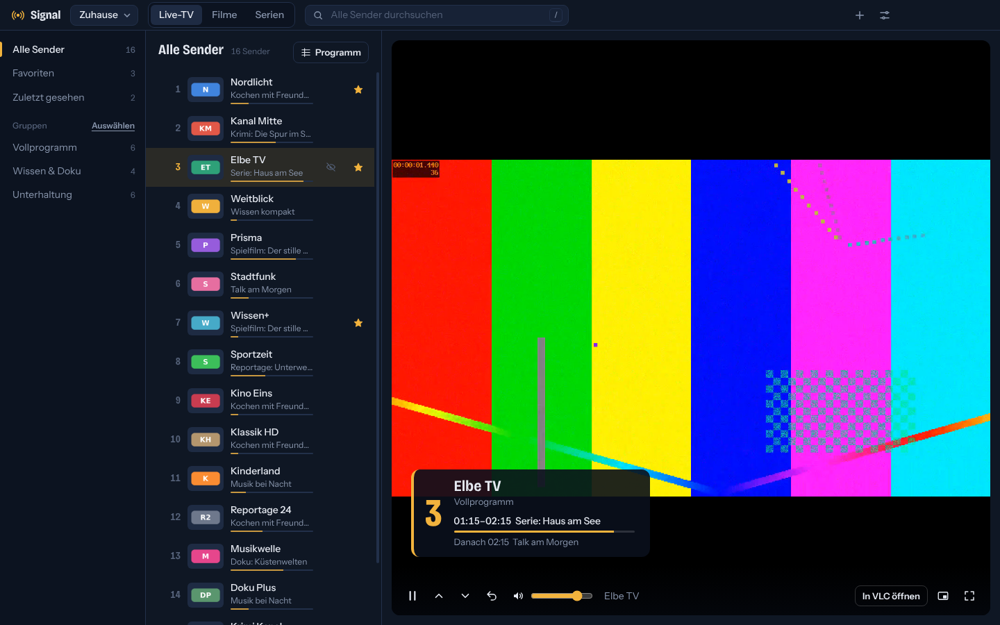
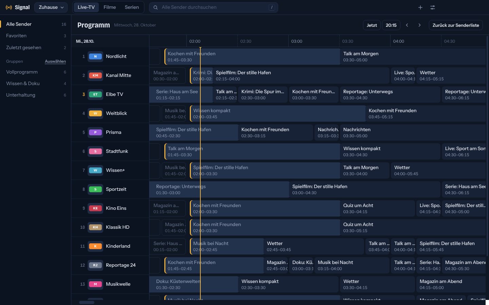
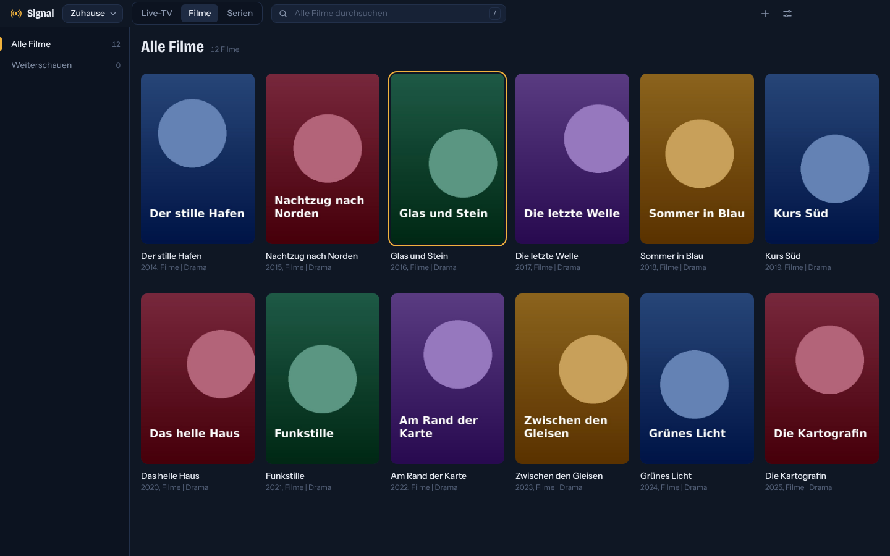
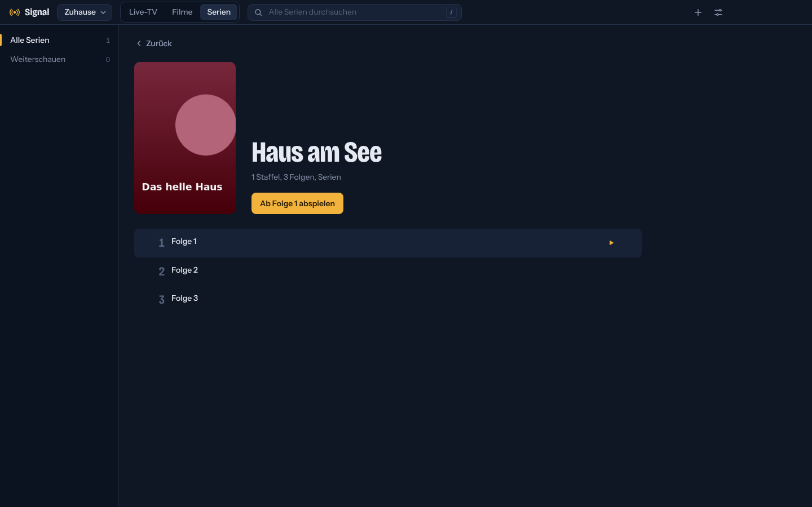
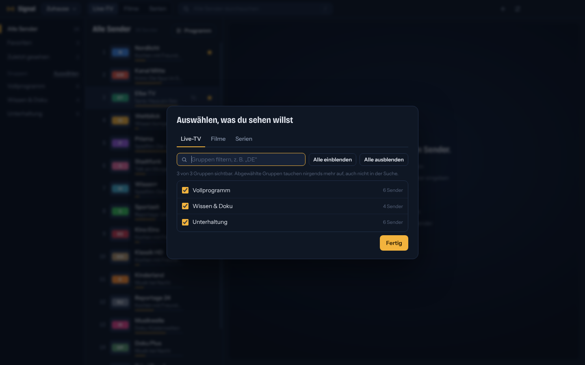

# Signal

**Ein moderner, übersichtlicher IPTV-Player für Windows.** Für deine eigenen M3U-Playlisten, kostenlos und quelloffen.

Signal enthält keine Sender, Filme oder Serien. Du bringst deine eigene Playlist mit, zum Beispiel von deinem
Kabel- oder TV-Anbieter oder vom eigenen TV-Server. [Mehr dazu weiter unten.](#wo-bekomme-ich-legale-playlisten)

## Was Signal kann

- **Live-TV, Filme und Serien** getrennt und automatisch aus der Playlist erkannt, mit Postern, Staffeln und „Weiterschauen“
- **Programmführer:** was gerade läuft, direkt in der Senderliste, und eine Programmübersicht als Zeitraster
- **Ruckelfreie Wiedergabe** auch bei wackeligen Servern, mit Vorpuffer und automatischem Nachpuffern
- **Tonspuren wählen**, die Sprache merkt sich Signal für alle Sender
- **Aussortieren:** Sender oder ganze Gruppen ausblenden, die du nie siehst
- **Suche über alles**, nicht nur in der offenen Gruppe
- **Mehrere Playlisten** speichern und mit einem Klick wechseln
- **Mini-Player**, der im Vordergrund bleibt, und **Live zurückspulen** (bis zu 2 Minuten)
- Favoriten, Sendernummern wie bei der Fernbedienung, vorheriger Sender per Rücktaste
- Keine Werbung, kein Konto, keine Datensammelei

| | |
|---|---|
|  |  |
|  |  |

## Herunterladen

Die aktuelle Version gibt es unter [**Releases**](https://github.com/Leon510/signal/releases/latest):

- `Signal-Setup-x.y.z.exe`: Installer, legt Startmenü- und Desktop-Verknüpfung an
- `Signal-x.y.z-portable.exe`: ohne Installation, z. B. für einen USB-Stick

Voraussetzung ist Windows 10 oder 11 (64 Bit).

> **Windows zeigt eine Warnung?** Solange Signal nicht über den Microsoft Store kommt, ist der Installer nicht
> digital signiert. Windows SmartScreen meldet dann „Der Computer wurde durch Windows geschützt“.
> Klick auf **Weitere Informationen** und dann auf **Trotzdem ausführen**.

## Erste Schritte

1. Signal starten und den **Link zu deiner M3U-Playlist** einfügen oder eine Playlist-Datei öffnen.
2. Links eine Gruppe wählen und einen Sender anklicken.
3. Bringt deine Playlist einen Programmführer mit (`url-tvg` in der ersten Zeile), lädt Signal ihn automatisch.
   Sonst kannst du den EPG-Link unter **Einstellungen → Playlisten → Bearbeiten** eintragen.

Weitere Playlisten fügst du mit **+** oben rechts hinzu. Zwischen ihnen wechselst du über den Namen oben links
oder mit `Strg`+`1` bis `9`.

## Wo bekomme ich legale Playlisten?

Signal ist ein Player, wie VLC. Was du damit ansiehst, liegt in deiner Verantwortung. Legale Quellen sind zum Beispiel:

- **Dein Kabel-, Glasfaser- oder TV-Anbieter**, sofern er eine M3U-Senderliste für sein Netz anbietet.
- **Dein eigener Router oder Receiver:** Eine FRITZ!Box mit Kabelanschluss (DVB-C) oder viele SAT>IP-Receiver
  stellen eine M3U-Liste der empfangbaren Sender bereit.
- **Dein eigener TV-Server** wie TVHeadend, Jellyfin oder Emby mit Live-TV.
- **Frei empfangbare Sender**, die ihre Livestreams selbst öffentlich anbieten. Sammlungen wie
  [iptv-org](https://github.com/iptv-org/iptv) listen solche Streams auf. Prüfe trotzdem, ob ein Sender sein
  Programm in deinem Land frei zugänglich macht.

Angebote, die „alle Pay-TV-Sender für ein paar Euro“ versprechen, sind in aller Regel illegal. Dafür ist Signal
nicht gedacht.

## Tastatur

| Taste | Aktion |
|---|---|
| `↑` / `↓` | Durch die Senderliste bewegen, im Vollbild und Mini-Player umschalten |
| `Bild↑` / `Bild↓` | Sender wechseln |
| `0`–`9` | Sendernummer eingeben |
| `Rücktaste` | Vorheriger Sender |
| `←` / `→` | 10 Sekunden zurück oder vor (mit `Shift`: 1 Minute) |
| `Leertaste` | Pause |
| `F` / Doppelklick | Vollbild |
| `P` | Mini-Player |
| `G` | Programmübersicht |
| `A` | Tonspur wechseln |
| `S` / `H` | Favorit / Sender ausblenden |
| `N` | Nächste Folge (Serien) |
| `+` / `−` / Mausrad | Lautstärke, `M` stumm |
| `/` | Suche |
| `Strg`+`1`–`9` | Playlist wechseln |

## Häufige Fragen

**Ein Sender läuft ohne Ton.**
Manche Sender senden ihren Ton in Formaten, die die eingebaute Wiedergabe von Windows-Programmen auf
Chromium-Basis nicht kann, zum Beispiel Dolby Digital ohne passenden Windows-Decoder oder MP2. Hat der Sender
weitere Tonspuren, wählst du über **Tonspur** eine andere. Sonst hilft **In VLC öffnen**, dafür muss
[VLC](https://www.videolan.org/) installiert sein.

**Ein Sender hakt.**
Stell unter **Einstellungen → Wiedergabe** den Puffer auf **Hoch**. Signal vergrößert den Puffer nach Aussetzern
auch selbst. Hakt es weiter, liegt es meistens am Server des Anbieters.

**Der Programmführer bleibt leer.**
Nicht jede Playlist bringt einen mit. Trag den EPG-Link (XMLTV, oft `.xml` oder `.xml.gz`) unter
**Einstellungen → Playlisten → Bearbeiten** ein. Signal ordnet die Sendungen über die `tvg-id` und den Sendernamen zu.

**Wo speichert Signal meine Daten?**
Nur lokal unter `%APPDATA%\Signal`. Mehr dazu in der [Datenschutzerklärung](PRIVACY.md).

## Rechtlicher Hinweis

Signal ist ein reiner Abspieler. Es enthält, vermittelt oder empfiehlt keine Inhalte und steht in keiner
Verbindung zu Anbietern von Playlisten oder Sendern. Für die Inhalte deiner Playlist und die Berechtigung, sie
anzusehen, bist du selbst verantwortlich. Signal steht in keiner Verbindung zum Messenger „Signal“ oder zur
Signal Foundation.

## Mitmachen

Fehler und Ideen gern als [Issue](https://github.com/Leon510/signal/issues). Wie Signal aufgebaut ist und
wie du es selbst baust, steht in [docs/ENTWICKLUNG.md](docs/ENTWICKLUNG.md); Hinweise zum Mitarbeiten in
[CONTRIBUTING.md](CONTRIBUTING.md). Sicherheitslücken bitte nicht öffentlich melden, sondern wie in
[SECURITY.md](SECURITY.md) beschrieben.

## Lizenz

Signal steht unter der [MIT-Lizenz](LICENSE). Mitgelieferte Komponenten haben eigene Lizenzen, siehe
[THIRD_PARTY_NOTICES.md](THIRD_PARTY_NOTICES.md).

---

## English

**Signal is a modern, clean IPTV player for Windows** for your own M3U playlists. It includes live TV with an
electronic programme guide (XMLTV), movies and series with resume, audio track selection, hiding channels and
groups, multiple playlists, a mini player and smooth playback on unreliable servers. It is free, open source
(MIT) and collects no data.

Signal ships **without any channels or content**. Use playlists you are legally entitled to, for example from
your TV provider, your own router or receiver, or your own TV server. The user interface is currently German only.
Downloads are on the [Releases](https://github.com/Leon510/signal/releases/latest) page.
Signal is not affiliated with the Signal messenger or the Signal Foundation.
